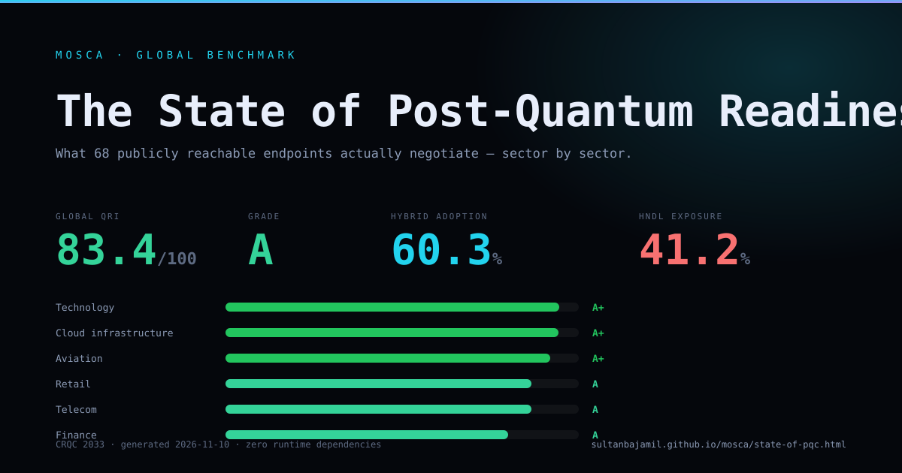

<p align="center">
  
</p>

<p align="center">
  <a href="https://github.com/sultanbajamil/mosca/actions/workflows/ci.yml"></a>
  <a href="scripts/check-zero-deps.js"></a>
  <a href="test/"></a>
  <a href="package.json">= 20" src="https://img.shields.io/badge/node-%E2%89%A520-339933"></a>
  <a href="LICENSE"></a>
  <a href="https://sultanbajamil.github.io/mosca/"></a>
  <a href="https://sultanbajamil.github.io/mosca/state-of-pqc.html"></a>
</p>

**MOSCA is the CI-native post-quantum exposure scanner.** It finds quantum-vulnerable cryptography in source, configuration, artefacts and dependencies; probes TLS, SSH, STARTTLS, QUIC and IKEv2; harvests recorded TLS and SSH handshakes from PCAP/PCAPNG; benchmarks global readiness by sector; and emits the artefacts an auditor, a CISO and a build pipeline each need.

```text
  ███╗   ███╗ ██████╗ ███████╗ ██████╗ █████╗
  ████╗ ████║██╔═══██╗██╔════╝██╔════╝██╔══██╗
  ██╔████╔██║██║   ██║███████╗██║     ███████║
  ██║╚██╔╝██║██║   ██║╚════██║██║     ██╔══██║
  ██║ ╚═╝ ██║╚██████╔╝███████║╚██████╗██║  ██║
  ╚═╝     ╚═╝ ╚═════╝ ╚══════╝ ╚═════╝╚═╝  ╚═╝
  post-quantum exposure scanner · zero runtime dependencies · Node ≥ 20
```

---

## Why It Matters Today (The 30-Second Executive Pitch)

Your adversaries are not waiting for the quantum computer. They are **recording now** — TLS sessions, SSH handshakes, backups, API traffic — and storing the ciphertext until the machine arrives. That attack has a name: **harvest now, decrypt later**.

The only question that matters is temporal:

> **If an adversary records this traffic today, when does it become readable?**

MOSCA answers it with **Mosca's inequality**:

```text
exposed  ⇔  data shelf life + migration lead time  >  years until a CRQC
```

If a hospital must keep patient records secret for 25 years, and a cryptographically relevant quantum computer (CRQC) arrives in 7, the data is **already exposed** — even if every server negotiates TLS 1.3 with a perfect classical cipher. A vendor roadmap does not fix the recording that was made last Tuesday.

MOSCA turns that theorem into an operating system for migration: a score, a ranked inventory, a baseline gate, a bill of materials, a fix plan, a passive capture audit, and a sector benchmark you can put in front of a board.

**The uncomfortable headline from our own benchmark:** across **68 publicly reachable endpoints in 10 sectors**, only **60.3%** negotiate a post-quantum hybrid key exchange. At a 2033 CRQC, **41.2%** of observed endpoints carry data that stays secret longer than the machine takes to arrive. Energy trails at **C**; technology leads at **A+**. [Read the full benchmark →](https://sultanbajamil.github.io/mosca/state-of-pqc.html)

---

## What makes MOSCA different

| Capability | Typical crypto inventory | Typical TLS scanner | MOSCA |
| --- | --- | --- | --- |
| Source + config + artefacts + dependencies + live endpoints in one report | partial | no | **yes** |
| Raw TLS ClientHello that offers `X25519MLKEM768` and reports the server's choice | no | only if linked OpenSSL supports it | **yes** |
| SSH hybrid KEX and full host-key/cipher/MAC inventory from raw `SSH_MSG_KEXINIT` | no | no | **yes** |
| Passive PCAP/PCAPNG harvesting with capture-date-anchored HNDL exposure | no | no | **yes** |
| Mosca-inequality exposure per finding, not just a severity label | no | no | **yes** |
| Baseline diff that fails only on regressions | no | rarely | **yes** |
| CycloneDX 1.6 CBOM + SARIF 2.1.0 + Mermaid + self-contained HTML | sometimes | no | **yes** |
| Global sector benchmark with an interactive CRQC slider | no | no | **yes** |
| Dynamic QRI/HNDL SVG badges generated locally | no | no | **yes** |
| Zero runtime dependencies, pure ESM, Node ≥ 20 | rarely | rarely | **yes** |

### What v3.1 adds

| Area | What it does |
| --- | --- |
| **`mosca pcap`** | Reads classic PCAP (micro/nanosecond, both endiannesses) and PCAPNG (SHB/IDB/EPB/SPB). Decodes Ethernet, 802.1Q, Linux SLL/SLL2, NULL and raw IP; reassembles TCP; parses TLS ClientHello/ServerHello and SSH banners + KEXINIT. Reports the **HNDL Captured Ratio** and anchors exposure to the recording date, not today. |
| **`mosca benchmark`** | Probes a curated global target set across 10 sectors with concurrency ≤ 10 and a 5-second timeout. Produces sector QRI, hybrid adoption, HNDL exposure at the sector's data lifetime, key-exchange distribution and classical debt. Reproducible from a snapshot. |
| **State of PQC page** | A self-contained dark report with an A+–F leaderboard, sector filters, a 2027–2045 CRQC slider and screenshot-ready insight cards: [`docs/state-of-pqc.html`](docs/state-of-pqc.html). |
| **SVG badges** | `--badge <dir>` writes `mosca-qri-badge.svg` and `mosca-hndl-badge.svg` from the scan itself. No third-party badge service, no network call. |
| **npm packaging** | `bin`, `exports`, `files`, `engines` and keywords are ready for publication, so `npx mosca-pqc scan .` works without a clone. |

---

## Try It in 10 Seconds

No install, no build step, no `node_modules`.

### 1. Scan a repository

```bash
npx mosca-pqc scan .
# or, before the npm release:
npx github:sultanbajamil/mosca scan .
```

```console
   30.8 / 100   █████████░░░░░░░░░░░░░░░░░░░░░░░░

  Mosca window   7 years to a CRQC (2033)
  HNDL exposure  100% of internet-facing key exchange is classical-only
  Findings       60 total · 52 actionable · 52 inside the Mosca window
  Surface        10 source files · 3 config files · 1 TLS · 1 SSH
```

### 2. Probe TLS endpoints

```bash
npx mosca-pqc tls cloudflare.com github.com
```

```console
  ✓ cloudflare.com
      protocol   TLS 1.3
      key xchg   ● X25519+ML-KEM-768  (post-quantum hybrid)
  ✓ github.com
      key xchg   ○ X25519  (breaks under Shor)
```

The probe writes the ClientHello by hand, so it can test `X25519MLKEM768` even when the local OpenSSL cannot negotiate it.

### 3. Probe SSH servers

```bash
npx mosca-pqc ssh git.example.com:2222 bastion.example.com
```

It exchanges identification strings, sends a minimal `SSH_MSG_KEXINIT`, and reports the server's advertised KEX, host-key, cipher and MAC lists. It never authenticates and never completes key exchange.

### 4. Audit a capture without sending a packet

```bash
npx mosca-pqc pcap capture.pcap --out capture-report
```

```console
  CAPTURED SESSIONS  ·  1 session from 1 file

  HNDL Captured Ratio  100% of recorded sessions are classical-only
  Servers recorded    1 · 1 TLS · 0 SSH

  CAPTURED              PROTO  SERVER                        NEGOTIATED                    HNDL
  ──────────────────────────────────────────────────────────────────────────────────────────────
  2016-05-01 00:00:00   TLS    bank.example:443              X25519                        ○ EXPOSED
```

Point it at an old packet capture and the report tells you whether the recording is already a disclosure in progress.

### 5. Benchmark the world

```bash
npx mosca-pqc benchmark --out benchmark-report
# reproducible replay used by the published page:
npx mosca-pqc benchmark --snapshot benchmarks/snapshot.json --out benchmark-report
```

```console
  83.4/100  A  Strong
  hybrid adoption 60.3%  ·  HNDL exposure 41.2%  ·  observed 68/69  ·  CRQC 2033
```

Open `benchmark-report/state-of-pqc.html` and move the CRQC slider.

---

## Install

```bash
# one-off
npx mosca-pqc scan .

# global CLI
npm install -g mosca-pqc
mosca scan .

# clone and run the source
git clone https://github.com/sultanbajamil/mosca.git
cd mosca
node bin/mosca.js scan /path/to/repo --tls example.com,github.com --out report
```

Requires **Node.js 20 or newer**. Pure ESM. **Zero runtime dependencies** — enforced in CI by [`scripts/check-zero-deps.js`](scripts/check-zero-deps.js).

The scan writes `mosca-report/mosca-report.html` by default: one file, no external fonts, scripts or images, safe to email or publish to GitHub Pages. A generated example is live at **https://sultanbajamil.github.io/mosca/**.

### Commands

```bash
mosca scan [path] [options]     # source + config + artefacts + deps + live endpoints
mosca tls <host...>             # probe live TLS endpoints only
mosca ssh <host...>             # probe SSH servers only
mosca starttls <target...>      # probe SMTP/IMAP/POP3/PostgreSQL/LDAP STARTTLS
mosca quic <host...>            # probe QUIC / HTTP/3
mosca ikev2 <host...>           # probe IPsec gateways for RFC 9370 hybrid KEX
mosca pcap <file...>            # harvest recorded TLS/SSH sessions from PCAP/PCAPNG
mosca benchmark [options]       # global sector readiness benchmark
mosca fix [path]                # propose a patch, plus manual advisories
mosca explain <algorithm>       # why an algorithm is exposed and what replaces it
mosca demo                      # scan the bundled vulnerable estate
mosca init                      # write a starter mosca.json
mosca rules                     # show the rule inventory
```

### Common options

| Flag | Meaning |
| --- | --- |
| `--tls <host,...>` | TLS endpoints to inspect (or set `endpoints` in `mosca.json`) |
| `--ssh <host,...>` | SSH targets to inspect (or set `ssh` in `mosca.json`) |
| `--starttls <target,...>` | STARTTLS targets (`smtp://`, `imap://`, `pop3://`, `postgres://`, `ldap://`) |
| `--quic <host,...>` | QUIC / HTTP/3 endpoints |
| `--ikev2 <host,...>` | IKEv2 gateways |
| `--pcap <file,...>` | PCAP/PCAPNG captures to harvest |
| `--badge <dir>` | Write `mosca-qri-badge.svg` and `mosca-hndl-badge.svg` |
| `--compliance <id>` | `cnsa2`, `nist-2030`, `pci-dss`, `hipaa` or `all` |
| `--fail-on-compliance <id>` | Exit 1 when the selected standard fails |
| `--fix` | Write `<out>/mosca-fix.patch` and print the fix plan |
| `--baseline <file>` | Compare against a baseline; `--fail-on` considers only new findings |
| `--write-baseline <file>` | Write this run's findings as the new baseline |
| `--format <list>` | `html,json,cbom,sarif,term,mermaid` (default `html,term`) |
| `--out <dir>` | Output directory |
| `--fail-on <severity>` | Exit 1 at or above `low`, `medium`, `high`, `critical` |
| `--scenario <name>` | `aggressive` (2029), `moderate` (2033), `conservative` (2038) |
| `--crqc-year <year>` | Explicit CRQC assumption |
| `--shelf-life <years>` | Default confidentiality lifetime |
| `--top <n>` | Findings shown in the terminal (default 20) |
| `--quiet` | Suppress the terminal report |
| `--no-color` | Disable ANSI colour |

Benchmark-specific options: `--targets <file>`, `--snapshot <file>`, `--concurrency <n>` (capped at 10), `--timeout <ms>` (default 5000), `--crqc-year <year>`.

---

## Passive capture harvesting (`mosca pcap`)

Most PQC tools ask what a server supports **now**. A capture answers a harder question: what did this session actually negotiate **when it was recorded**?

```bash
mosca pcap capture.pcap --out capture-report --format html,cbom,sarif,json
mosca scan . --pcap capture.pcap --badge badges
```

What is parsed, with no native packet library:

- **Formats:** classic libpcap (big/little endian, microsecond and nanosecond magic) and PCAPNG Section Header, Interface Description, Enhanced Packet and Simple Packet blocks, including per-interface `if_tsresol`.
- **Link layers:** Ethernet with stacked 802.1Q/802.1ad VLAN tags, Linux SLL and SLL2, BSD NULL/loopback and raw IP.
- **Network/transport:** IPv4 and IPv6 (including extension headers and first-fragment handling), TCP payload reassembly across segments and records.
- **TLS:** ClientHello (SNI, offered groups, key shares, ALPN, supported versions) and ServerHello (selected version, cipher suite, group). That yields the **negotiated** hybrid posture, not the server's advertised list.
- **SSH:** identification banners and `SSH_MSG_KEXINIT` name-lists, with **first-match agreement** between the two directions. Hybrid KEX is recognised (`mlkem768x25519-sha256`, `sntrup761x25519-sha512@openssh.com`) along with legacy host keys, weak KEX, CBC ciphers and MD5/SHA-1 MACs.
- **Exposure:** the Mosca inequality is anchored to `captureYear`. A ten-year secret recorded in 2010 is judged against 23 years to a 2033 CRQC, not the seven years a fresh scan would show.

The capture is opened read-only. The command sends **zero packets**, performs **no authentication**, and never writes private key material. Captured sessions become `captured-session` assets in the HTML report, CBOM and SARIF, and contribute the **HNDL Captured Ratio** — the share of recorded sessions that are classical-only.

---

## Global benchmark (`mosca benchmark`)

A single scan says whether one host is ready. A benchmark says whether a **sector** is ready, and how long its data stays secret after the recording.

```bash
mosca benchmark --out benchmark-report
mosca benchmark --snapshot benchmarks/snapshot.json --out benchmark-report
node scripts/benchmark-world.js --live --write-snapshot benchmarks/snapshot.json
```

- Target set: [`benchmarks/targets.json`](benchmarks/targets.json) — 69 named organisations across finance, healthcare, government, technology, cloud, telecom, retail, energy, aviation and education.
- Probing: TLS ClientHello + optional SSH KEXINIT, concurrency capped at **10**, per-probe timeout **5 s**, no authentication.
- Scoring: start at 100; `−40` TLS without hybrid KEX, `−20` legacy TLS, `−15` weak cipher, `−15` SSH without hybrid KEX, `−5` per additional classical-debt signal (capped at `−20`). Grades: A+ ≥ 90, A ≥ 80, B ≥ 70, C ≥ 60, D ≥ 50, E ≥ 40, F < 40.
- HNDL: a sector is exposed when `data lifetime + 1-year migration lead > years to CRQC`. Healthcare and government use a 25-year lifetime; technology and cloud use 7.
- Reproducibility: [`benchmarks/snapshot.json`](benchmarks/snapshot.json) stores the raw handshake shapes, so CI and the published page replay exactly the same numbers.

The HTML report is self-contained: an A+–F leaderboard you can sort, per-sector filters, a **2027–2045 CRQC slider**, and insight cards built to be screenshotted:

[](docs/state-of-pqc.html)

> The preview above is rendered from the current snapshot. The interactive version is [`docs/state-of-pqc.html`](docs/state-of-pqc.html).

---

## Badges that are evidence, not decoration

```bash
mosca scan . --badge badges
```

```html


```

The QRI badge shows `94/100 (A+)`; the HNDL badge shows `0% SAFE` or the percentage of classical-only exposure. Both are generated locally from the scan summary — no shields.io, no token, no telemetry. The GitHub Action exposes `badges` as an output, so a workflow can commit them to a `badges/` branch or attach them to a release.

---

## CI gating and baseline mode

A gate that fails on every historical finding gets switched off. Record the estate once, commit the baseline, then fail only on regressions:

```bash
# once, on the current commit
mosca scan . --write-baseline .mosca-baseline.json

# in CI: existing debt is accepted, new exposure fails the build
mosca scan . \
  --baseline .mosca-baseline.json \
  --format sarif --out out --fail-on high
```

Fingerprints exclude line numbers, so moving a function does not manufacture a new finding. Every SARIF result carries a stable `partialFingerprints.moscaFingerprint`; the HTML report marks regressions with a `new` badge and a one-click filter. A rendered example is at [`docs/baseline-demo.html`](docs/baseline-demo.html).

### GitHub Action

```yaml
- name: MOSCA
  uses: sultanbajamil/mosca@v3
  with:
    path: .
    tls: example.com,api.example.com
    ssh: bastion.example.com
    starttls: smtp://mail.example.com:587
    quic: example.com
    ikev2: vpn.example.com
    pcap: captures/edge.pcap
    badge: badges
    compliance: cnsa2
    fail-on-compliance: cnsa2
    baseline: .mosca-baseline.json
    fail-on: high
    format: html,sarif,json,cbom,mermaid
    benchmark-snapshot: benchmarks/snapshot.json

- name: Upload SARIF
  if: always()
  uses: github/codeql-action/upload-sarif@v3
  with:
    sarif_file: mosca-report/mosca.sarif
```

---

## Compliance gates

A readiness score is useful for prioritisation but useless in an audit. The compliance engine maps each enriched finding onto named controls and reports pass, partial or fail per standard:

```bash
mosca scan . --compliance cnsa2
mosca scan . --compliance all --fail-on-compliance pci-dss
```

| Standard | Focus |
| --- | --- |
| `cnsa2` | ML-KEM key establishment, ML-DSA signatures, AES-256, SHA-384 |
| `nist-2030` | Deprecate RSA/ECC/DSA/EdDSA by 2030 and remove by 2035 |
| `pci-dss` | TLS 1.2+, no RC4/3DES/DES, RSA-2048+, no MD5/SHA-1, HNDL |
| `hipaa` | ePHI in transit and at rest, integrity, long-retention HNDL |

Each violation carries the finding fingerprint, algorithm and location, so the SARIF result itself names the control it breaks. Captured sessions are evaluated as protocol assets, which makes a PCAP audit usable as evidence rather than an anecdote.

---

## Fix plans and diagrams

`mosca fix` is deliberately conservative. It only generates a textual hunk when the change is a literal swap of a hash, MAC or AES key size — never inside a protocol implementation or a test vector. Everything else becomes an advisory:

```bash
mosca fix .
# out/mosca-fix.patch — review with `git apply --check`, then apply deliberately
```

Signatures, key agreement, certificates, configuration, lockfiles and live listeners are always manual: those are trust-chain or protocol migrations, not find-and-replace. MOSCA never edits a file in the `fix` command.

```bash
mosca scan . --format mermaid --out out
# out/mosca.mmd            risk graph
# out/mosca-diagrams.md    risk graph, certificate chains and supply chain
```

Diagrams are bounded and deterministic, so a committed diagram does not churn on every scan.

---

## Configuration

`mosca init` writes a starter file. Everything that shapes the model is configurable:

```json
{
  "scenario": "moderate",
  "defaultShelfLife": 7,
  "endpoints": ["example.com", "api.example.com:8443"],
  "ssh": ["bastion.example.com", "git.example.com:2222"],
  "pcap": ["captures/edge.pcap"],
  "dataClasses": [
    { "pattern": "**/health/**", "years": 25, "label": "health records" },
    { "pattern": "**/billing/**", "years": 10, "label": "billing records" }
  ],
  "ignore": ["**/fixtures/**"]
}
```

Data classes are matched against file paths and directly change the exposure calculation: the same MD5 in `health/` and in `util/` is not the same risk.

### Suppressing findings

```js
// mosca-ignore-line -- legacy detector, not a policy
minVersion: 'TLSv1',

// mosca-ignore-next-line -- third-party protocol requirement
crypto.createHash('md5');

// mosca-ignore-file -- generated compatibility shim
```

Suppressed findings never reach the report, and the terminal output shows how many were suppressed, so a clean scan cannot hide a pile of exceptions. Use a reason: the next reader needs to know why the line is safe, not just that someone silenced it.

---

## Output

### Terminal

Ranked findings with severity, priority, location, replacement and the Mosca inequality behind each one:

```text
  SEV         PRI  NEW  ALGORITHM             LOCATION                          REPLACE WITH
  ─────────────────────────────────────────────────────────────────────────────────────────
   CRITICAL   P0   NEW  SHA-1                 services/identity/main.go:30      SHA-256
   CRITICAL   P0        MD5                   src/api/auth.js:34                SHA-256
   CRITICAL   P0        RC4                   infra/nginx.conf:18               AES-256-GCM
   HIGH       P1        RSA                   services/identity/main.go:20      ML-KEM-768

  CRQC sensitivity  2029: 48  ·  2033: 48  ·  2038: 8  ·  2045: 0  exposed findings
```

`mosca explain <algorithm>` turns the registry into a one-screen migration brief:

```console
$ mosca explain rsa
  RSA  (rsa)
  Primitives     pke, signature
  Quantum        broken
  Classical      acceptable
  Replace with   ML-KEM-768 (ml-kem-768)
  Standard       FIPS 203 (ML-KEM) / FIPS 204 (ML-DSA)
  Hybrid form    X25519MLKEM768
```

### Interactive HTML

The report renders Mosca's inequality as a timeline. Drag the CRQC line and every bar is re-evaluated in the browser — no server, no JavaScript bundle, no network access. It also contains:

- a **crypto-agility simulator** that re-scores the estate as you move the CRQC year, scale migration speed and assume a hybrid-key-exchange rollout;
- an **X.509 chain tree** for every inspected TLS endpoint, with the weakest link highlighted and the projected post-quantum flight size against the 14 KB initial congestion window;
- **compliance cards** for CNSA 2.0, NIST 2030, PCI DSS and HIPAA, naming each failed control and its remediation;
- a **captured-session section** with the recording time, negotiated KEX and the Mosca inequality anchored to that date;
- a **cryptographic supply-chain table** of lockfile packages and an **on-disk artefact table** (PEM, DER, JWK, OpenSSH);
- the findings table with severity and "new since baseline" filters, TLS, SSH, STARTTLS, QUIC and IKEv2 endpoint cards, a CRQC sensitivity strip, the algorithm inventory and the phased roadmap.

### CBOM (CycloneDX 1.6)

```bash
mosca scan . --format cbom --out out
# out/bom.cdx.json — cryptographic-asset components with
# cryptoProperties.algorithmProperties, NIST quantum level, and
# mosca:* properties (status, replacement, inequality, location).
# TLS, SSH and captured sessions appear as protocol assets.
# Lockfile packages appear as library components, and the top-level
# `dependencies` graph connects them to the application.
```

### SARIF 2.1.0

Every actionable code finding becomes a SARIF result with a stable, line-independent `partialFingerprints.moscaFingerprint`, so GitHub code scanning tracks an issue across commits instead of re-opening it. Baseline runs also set `baselineState` to `new` or `unchanged`. With `--compliance`, each result gains a `properties.compliance` list naming the standards and controls it violates.

---

## How the score works

Each finding is scored 0–100 from five normalised factors:

| Factor | Weight | What it measures |
| --- | --- | --- |
| Quantum | 0.40 | Shor breaks it vs. Grover halves it vs. safe |
| Durability | 0.20 | Years the protected data must stay secret |
| Breadth | 0.15 | How widely the primitive is used (migration cost) |
| Classical | 0.15 | Whether it is broken *today* |
| Surface | 0.10 | Internet-facing endpoint vs. config vs. source |

Severity bands are deliberately asymmetric: anything classically broken is **critical** regardless of the numeric score, because it is exploitable now, not in 2033. Captured sessions inherit the transport-payload shelf life but anchor the inequality to the capture year. The full model, including every constant and its justification, is in [`docs/METHODOLOGY.md`](docs/METHODOLOGY.md).

The benchmark uses a separate readiness score (documented in [`docs/METHODOLOGY.md`](docs/METHODOLOGY.md#benchmark-scoring)) because "how ready is this endpoint?" and "how exposed is this finding?" are different questions.

---

## Demo

The repository ships an intentionally insecure estate — Node, Python, Go, Java, nginx, sshd, OpenSSL and a shell deployment script — so the scanner can be evaluated without pointing it at real code.

```bash
npm run demo
```

Expected result: **56 findings** (source, configuration, one on-disk RSA artefact and two lockfile packages), QRI **23.9/100**, roughly **27 engineer-days** of estimated migration effort across **51 unique migration sites**, in under a second. Add live endpoints for the full picture:

```bash
node bin/mosca.js demo --tls cloudflare.com,github.com,en.wikipedia.org,example.com \
  --ssh github.com --starttls smtp://gmail-smtp-in.l.google.com:25 --quic cloudflare.com
```

---

## Development

```bash
npm run check   # zero-dependency guard + 231 tests
npm test        # node:test only
npm run demo
npm run benchmark:replay
```

No build step, no transpiler, no test framework to install. The suite covers the algorithm registry invariants, rule true/false positives, DER X.509 parsing against a real certificate, ClientHello construction and ServerHello parsing, RFC 9001 QUIC Initial key derivation against the Appendix A.1 vectors, the STARTTLS and IKEv2 wire formats, X.509 chain analysis, lockfile parsing, artefact scanning, constant propagation, all four compliance standards, the fix planner, the risk model, PCAP/PCAPNG parsing with generated binary fixtures, the benchmark engine, badge rendering, every report format and an end-to-end scan.

See [`docs/ARCHITECTURE.md`](docs/ARCHITECTURE.md) for the module map and wire-format details, and [`CONTRIBUTING.md`](CONTRIBUTING.md) for how to add a rule.

---

## Honest limitations

- **Planning model, not prophecy.** The CRQC year is an assumption you choose, not a prediction. The report exposes the assumption rather than hiding it.
- **Static analysis has false positives.** Rules are regex-based for speed and zero dependencies. Confidence levels are reported and low-confidence findings are downgraded one severity band.
- **The probe measures the selected group, not full PQC readiness.** A hybrid key exchange does not fix a classical certificate signature; the report keeps those as separate findings.
- **SSH live results describe advertised algorithms, not the negotiated ones.** The probe reads the server's KEXINIT and hangs up. A captured session is different: `mosca pcap` performs first-match agreement between both KEXINIT lists, which is what the recording actually used.
- **A capture only contains what it contains.** Missing packets, TLS 1.3 encrypted handshakes after the ServerHello, and non-TCP transports are reported as unobserved rather than guessed.
- **The benchmark measures publicly reachable endpoints.** It is a floor, not an estate census: internal services, authenticated APIs and configuration drift are out of scope.
- **Baseline fingerprints are content-based.** Two identical calls on two identical lines in the same file collapse into one baseline entry. That is intentional: the baseline records the defect, not the line count.
- **No authenticated scanning.** `mosca` does not log in, crawl authenticated pages, or test application logic.
- **TLS 1.0/1.1 acceptance is probed with a raw ClientHello.** Some CDNs answer legacy probes even when the property's policy claims otherwise; treat the finding as "this edge still negotiates legacy TLS" and verify at the origin.

---

## Launch kit

The narrative around the release lives in [`docs/launch-kit/`](docs/launch-kit/):

- [`hacker-news-show-hn.md`](docs/launch-kit/hacker-news-show-hn.md)
- [`state-of-pqc-press-release.md`](docs/launch-kit/state-of-pqc-press-release.md)
- [`social-threads-ar-en.md`](docs/launch-kit/social-threads-ar-en.md)
- [`ciso-one-pager.md`](docs/launch-kit/ciso-one-pager.md)

---

## License

MIT. See [`LICENSE`](LICENSE).

## References

FIPS 203, FIPS 204, FIPS 205 · NIST IR 8547 (draft) · RFC 8446, RFC 8996 · `draft-ietf-tls-ecdhe-mlkem` · RFC 4253, RFC 8308 · RFC 9001 · RFC 9370 · CycloneDX 1.6 · SARIF 2.1.0 · CNSA 2.0 · Mosca, *Cybersecurity, an adversary's view* (2018).
